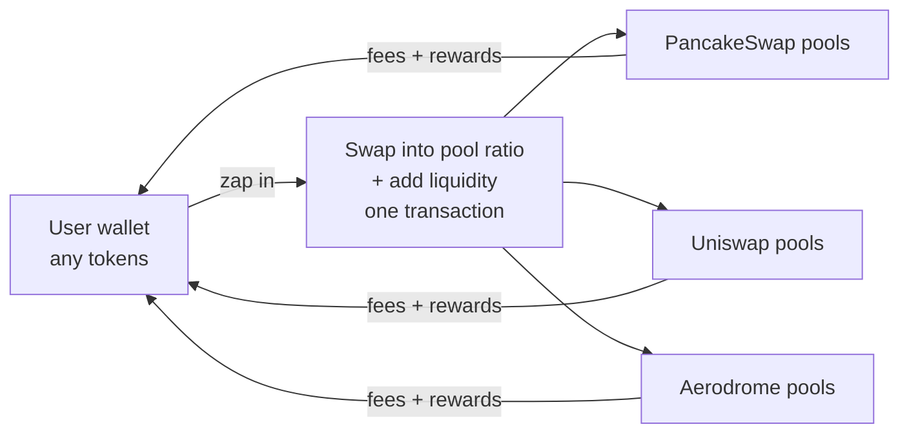
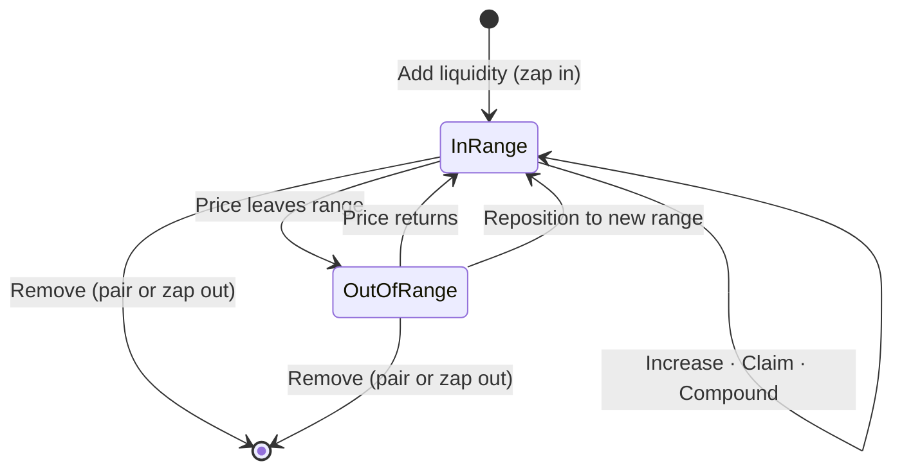

  <picture>
    <source media="(prefers-color-scheme: dark)" srcset="https://docs.dyxy.io/logo/dark.svg">
    
  </picture>

# DYXY Pools

How DYXY Pools brings liquidity pools from PancakeSwap, Uniswap and Aerodrome into one interface: zap in with any token, choose a price range, and manage every position in one place.

> This repository describes how the product works. It does not contain DYXY source code. User guide: [docs.dyxy.io/earn/pools](https://docs.dyxy.io/earn/pools/overview).

## Overview

Liquidity always goes directly into the protocol's own contracts. DYXY charges no fee on pools.

## Earnings

| Source | How it accrues |
| --- | --- |
| Trading fees | Every swap through the pool pays a fee tier (e.g. 0.05%, 0.3%), shared by in-range liquidity in proportion to its share |
| Farming rewards | Some pools distribute extra tokens such as CAKE or AERO |

## Protocols

| Protocol | Pool types | Rewards |
| --- | --- | --- |
| PancakeSwap | v3 concentrated, v2 classic | Fees, CAKE farming on many pools |
| Uniswap | v3 concentrated, v2 classic, v4 where available | Fees |
| Aerodrome | Slipstream concentrated, classic stable and volatile | AERO emissions on gauge pools |

## Position lifecycle

| Action | What happens |
| --- | --- |
| Zap in | Any tokens are swapped into the pool ratio and added in one transaction |
| Increase | More liquidity added to the same position and range |
| Claim | Fees and rewards sent to the wallet, liquidity untouched |
| Compound | Earned fees reinvested into the position |
| Reposition | Liquidity moved to a new range in one transaction |
| Remove | Partial or full, as the pool's two tokens or zapped out into one token |

## Documents

| Document | Contents |
| --- | --- |
| [Concentrated liquidity](docs/concentrated-liquidity.md) | Ranges, presets, in and out of range, impermanent loss |
| [Choosing a pool](docs/choosing-a-pool.md) | Fee tier, volume to TVL, rewards, network costs |

## License

Text and diagrams in this repository are licensed under [CC BY 4.0](LICENSE). The DYXY name and logo are not covered by this license.
