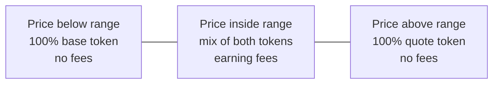

# Concentrated liquidity

In concentrated liquidity pools (Uniswap v3 and v4, PancakeSwap v3, Aerodrome Slipstream) a liquidity provider chooses a price range. Liquidity only trades, and only earns fees, while the price is inside it.

## Range versus earnings

| Range | Fees while in range | Chance of leaving range | Maintenance |
| --- | --- | --- | --- |
| Narrow | Highest | High | Frequent |
| Medium | Moderate | Moderate | Occasional |
| Wide | Lowest | Low | Rare |
| Full range | Like a classic pool | Never | None |

## Position composition by price

**Example.** ETH/USDC at $4,000 with a $3,600 to $4,400 range:

- Between $3,600 and $4,400 the position earns fees.
- Above $4,400 it is entirely USDC, having sold ETH on the way up.
- Below $3,600 it is entirely ETH, having bought ETH on the way down.

## Presets

| Preset | Use |
| --- | --- |
| Stable | Very narrow, for pairs near a fixed ratio such as USDC/USDT |
| Narrow | Active management on major pairs |
| Common | Balanced default for volatile pairs |
| Wide | Volatile pairs managed rarely |
| Full range | Never goes out of range |

## Impermanent loss

Impermanent loss is the gap between the value of the LP position and simply holding the two tokens. It grows with the price move, and faster in narrow ranges, because the position converts from one token to the other over a shorter distance. Fees earned may or may not offset it.
